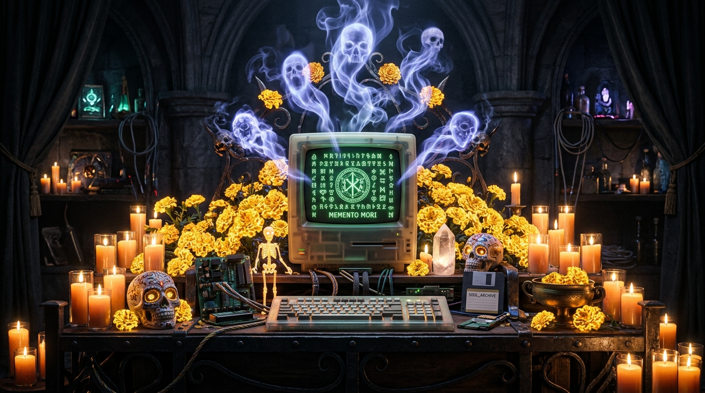
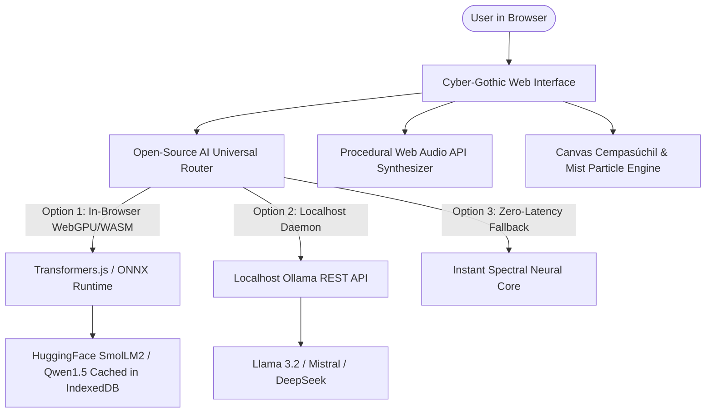

# Ghost in the Machine: NecroOS & The Digital Ofrenda
> **Build something with open-source AI at its core. Spooky, or honoring the past in the spirit of Día de los Muertos.**
> *A client-side, air-gapped web application powered by open-weight models.*



[](https://opensource.org/licenses/MIT)
[](https://huggingface.co)
[](#why-open-innovation-matters)
[](#)

---

## 🌟 Overview

**Ghost in the Machine** is an interactive cyber-gothic workstation and sacred digital ofrenda built with HTML5, Vanilla CSS, and JavaScript. It bridges the thin boundary between Halloween and Día de los Muertos (October 31 – November 2), when memory defies mortality.

The application has **open-source AI at its core**, executing inference locally via in-browser open-weight models (Transformers.js / WebGPU), local Ollama instances, or an instant offline spectral engine with **zero server telemetry**.

---

## 🔮 Core Features

### 1. ⚡ The Haunted Terminal (`NecroShell`)
- **Possessed CRT Console**: Authentic VT-100 phosphor green/amber display with scanlines, chromatic glitch jitter, and procedural mechanical key clicks.
- **Spooky Virtual Filesystem**: Inspect `memories.log`, `departed_souls.db`, `uncommitted_sins.git`, `cobol_legacy.dat`, and `manifesto.md`.
- **Ghost Interception**: Commands like `ls`, `cat`, `whoami`, `ps`, `kill -9 666`, and `git blame` provoke eerie whispers and metaphysical telemetry.
- **Direct Ghost Query**: Run `necro <question>` or `summon <ada|grace|cobol|flash|lisp>` right inside the shell.

### 2. 🕯️ Digital Ofrenda & Altar de Muertos
- **3-Tier Sacred Altar**: Glowing step tiers adorned with animated flickering candlelight and golden cempasúchil (marigold) garlands.
- **Pioneers of Computing**: Preloaded tributes honoring Ada Lovelace, Admiral Grace Hopper, Alan Turing, and abandoned open-source repositories.
- **Place Offerings**: Add fresh cempasúchil petals, votive candles, pan de muerto, clay coffee cups, and floppy disks.
- **Open-Weight AI Remembrances**: Generates poignant, culturally authentic blessings and eulogies completely on-device.
- **Add Custom Memorials**: Honor your own departed ancestors, late mentors, or lost code projects in local private storage.

### 3. 🕊️ Chamber of the Departed (Offline Séance)
- Channel long-departed innovators and technologies:
  - **Ada Lovelace** (1815–1852): Mother of programming & poetic science.
  - **Grace Hopper** (1906–1992): Compiler pioneer, nanoseconds, and the Mark II moth bug.
  - **The Ghost of COBOL** (1959–Present): The indestructible mainframe monolith running global finance.
  - **The Spirit of Adobe Flash** (1996–2020): Web 1.0 indie animation, anti-gatekeeping, and creative freedom.
  - **The Soul of LISP**: Primordial symbolic consciousness and recursive dreams.

### 4. 📡 Ghost Story & Sensor Anomaly Weaver
- Synthesizes raw IoT telemetry (attic motion vectors, sudden thermal drops, smart lock overrides, CPU load spikes) into bone-chilling paranormal micro-tales.
- Preloaded presets: *Smart Home Incident (03:17 AM)*, *The Dead Developer's Git Branch*, *Basement Server Rack Anomaly*, and *The Possessed Smart Mirror*.

### 5. 🔊 Procedural Spectral Audio (Web Audio API)
- Zero external MP3/WAV files required.
- Generates binaural haunted drones (55Hz sub-bass + fifth harmonics), mechanical keyboard relay clicks, EVP radio static bursts, and singing-bowl chimes entirely via browser math.

---

## 🏛️ Architecture: Open-Source AI at its Core



---

## 💡 Why Open Innovation Matters for What We Built

1. **Air-Gapped Privacy for Personal Grief**:
   An ofrenda is deeply sacred. Placing pictures of family ancestors or sharing personal memories should never be harvested to train commercial ad engines. Open-weight models running on user hardware guarantee 100% privacy.

2. **Perpetual Existence (No SaaS Sunset)**:
   When closed platforms shut down (as happened to Adobe Flash), millions of artworks and programs vanish forever. Open-weight models (ONNX/GGUF) will remain runnable 20, 50, or 100 years from now on open machines.

3. **Works with the Lights and Internet Off**:
   During Halloween storms or remote off-grid retreats, NecroOS boots instantly on laptop battery with WiFi completely disabled.

4. **Zero Cost & Sovereign AI**:
   No subscription fees, no credit card requirements, no rate limits, and no corporate content sanitization.

---

## 🚀 Quick Start

1. Clone or download this repository.
2. Open `index.html` in any modern web browser (Chrome, Edge, Firefox, Safari).
   - *Optional*: Serve with any static server:
     ```bash
     npx serve .
     # or python -m http.server 8000
     ```
3. Click the 🔇 button in the top right to awaken procedural spectral audio!
4. Switch AI modes anytime using the **ENGINE** button in the header.

---

## 📜 License
MIT License — Free and open for everyone.
